<!-- GitHub Profile README | wlgptjd333/wlgptjd333 -->

<picture><source media="(prefers-color-scheme: dark)" srcset="assets/638614c1/header-dark.svg"/></picture>

 

<a href="#-about"><picture><source media="(prefers-color-scheme: dark)" srcset="assets/638614c1/btn-nav-about-dark.svg"/></picture></a> <a href="#-highlights"><picture><source media="(prefers-color-scheme: dark)" srcset="assets/638614c1/btn-nav-highlights-dark.svg"/></picture></a> <a href="#-projects"><picture><source media="(prefers-color-scheme: dark)" srcset="assets/638614c1/btn-nav-projects-dark.svg"/></picture></a> <a href="#-tech-stack"><picture><source media="(prefers-color-scheme: dark)" srcset="assets/638614c1/btn-nav-stack-dark.svg"/></picture></a> <a href="#-links"><picture><source media="(prefers-color-scheme: dark)" srcset="assets/638614c1/btn-nav-links-dark.svg"/></picture></a>

 

## 👋 About

> **모델을 학습시키는 데서 끝내지 않고, 누군가 실제로 실행해 볼 수 있는 형태까지 만듭니다.**

<picture><source media="(prefers-color-scheme: dark)" srcset="assets/638614c1/about-dark.svg"/></picture>

 

## ✨ Highlights

<picture><source media="(prefers-color-scheme: dark)" srcset="assets/638614c1/highlights-dark.svg"/></picture>

※ 개선 전 → 후. 막대의 세로선이 개선 전 위치이며, 각 수치는 아래 프로젝트 저장소의 README에 기록된 결과입니다.

<a href="#top"><b>↑ 맨 위로</b></a>

 

## 🚀 Projects

카드를 누르면 저장소로 이동합니다.

<a href="https://github.com/wlgptjd333/body-hero"><picture><source media="(prefers-color-scheme: dark)" srcset="assets/638614c1/project-body-hero-dark.svg"/></picture></a>

<table>
<tr><td width="96" nowrap><b>문제</b></td><td>체감형 게임은 전용 컨트롤러나 VR 장비가 필요합니다. <b>일반 웹캠 하나</b>로 펀치 · 어퍼컷 · 가드 · 스쿼트를 인식하고 싶었습니다.</td></tr>
<tr><td width="96" nowrap><b>수행</b></td><td>MediaPipe Pose 33개 관절 → 어깨 중심 정규화 → <b>4프레임 Conv1D + GAP</b> 경량 모델로 7가지 동작 분류 → 4단계 후처리(EMA · 히스테리시스 · 어퍼컷 게이팅 · 쿨다운) → UDP로 Godot 게임에 전달</td></tr>
<tr><td width="96" nowrap><b>결과</b></td><td>v1.1.0에서 같은 플레이 기록 재생 기준 어퍼컷 정답 <b>37.3% → 91.0%</b>, 다른 공격이 먼저 나간 비율 <b>24.8% → 4.0%</b> · GPU 없이 CPU만으로 동작 · Windows용 Release 배포</td></tr>
<tr><td width="96" nowrap><b>기술</b></td><td><code>Python</code> <code>MediaPipe</code> <code>1D-CNN</code> <code>Godot 4.6</code> <code>UDP</code></td></tr>
</table>

<a href="https://github.com/wlgptjd333/body-hero"><picture><source media="(prefers-color-scheme: dark)" srcset="assets/638614c1/btn-github-dark.svg"/></picture></a> <a href="https://github.com/wlgptjd333/body-hero/releases/latest"><picture><source media="(prefers-color-scheme: dark)" srcset="assets/638614c1/btn-download-dark.svg"/></picture></a>

<a href="#top"><b>↑ 맨 위로</b></a>

 

<a href="https://github.com/wlgptjd333/bean-leaf-disease-api"><picture><source media="(prefers-color-scheme: dark)" srcset="assets/638614c1/project-beans-dark.svg"/></picture></a>

<table>
<tr><td width="96" nowrap><b>문제</b></td><td>헤드만 학습한 기준선은 Test 정확도가 0.72에 그쳤고, 모델을 실제 요청으로 받을 <b>서비스 구조</b>도 필요했습니다.</td></tr>
<tr><td width="96" nowrap><b>수행</b></td><td><code>ResNet-18</code>을 <b>각진잎반점병 · 녹병 · 정상</b> 3클래스로 Fine-tuning · 제공 코드는 그대로 두고 <b>실행 옵션만</b> 바꿔 3가지 실험 비교 · Validation으로만 모델을 고른 뒤 Test는 1회만 평가</td></tr>
<tr><td width="96" nowrap><b>결과</b></td><td>Test 정확도 <b>0.72 → 0.98</b> (125 / 128장) · 녹병 재현율(Val) <b>0.64 → 0.96</b></td></tr>
<tr><td width="96" nowrap><b>서비스</b></td><td>FastAPI 동기 API(<b>22 ms</b>, 캐시 HIT 1.4 ms) · Celery 비동기 작업 · Redis 캐시/큐 · PostgreSQL 작업 기록 · 기능 테스트 <b>18 / 18</b> PASS</td></tr>
<tr><td width="96" nowrap><b>기술</b></td><td><code>PyTorch</code> <code>Transformers</code> <code>FastAPI</code> <code>Celery</code> <code>Redis</code> <code>PostgreSQL</code> <code>Docker</code></td></tr>
</table>

<a href="https://github.com/wlgptjd333/bean-leaf-disease-api"><picture><source media="(prefers-color-scheme: dark)" srcset="assets/638614c1/btn-github-dark.svg"/></picture></a>

<a href="#top"><b>↑ 맨 위로</b></a>

 

<a href="https://github.com/wlgptjd333/coin-float"><picture><source media="(prefers-color-scheme: dark)" srcset="assets/638614c1/project-coinfloat-dark.svg"/></picture></a>

<table>
<tr><td width="96" nowrap><b>문제</b></td><td>다른 앱을 쓰는 동안에도 시세를 보고 싶은데, 기존 앱은 화면을 크게 가리거나 앱을 전환해야 했습니다.</td></tr>
<tr><td width="96" nowrap><b>수행</b></td><td>여백 없는 <b>플로팅 오버레이</b> · WebSocket <b>1개 커넥션</b>으로 실시간 체결 수신 · 지수 백오프 자동 재연결 · 숨기면 수신도 멈춰 배터리 절약</td></tr>
<tr><td width="96" nowrap><b>확장</b></td><td>앱 내 차트(이동평균 · 볼린저 · RSI · MACD · 볼륨 프로파일 · 그리기 도구) · <b>Pine Script 지표 59종</b> · <a href="https://coinfloat.byhyesung.com/">웹 버전</a> · 설정 동기화</td></tr>
<tr><td width="96" nowrap><b>기술</b></td><td><code>Android</code> <code>JavaScript</code> <code>WebSocket</code> <code>Lightweight Charts</code></td></tr>
</table>

<a href="https://github.com/wlgptjd333/coin-float"><picture><source media="(prefers-color-scheme: dark)" srcset="assets/638614c1/btn-github-dark.svg"/></picture></a> <a href="https://coinfloat.byhyesung.com/"><picture><source media="(prefers-color-scheme: dark)" srcset="assets/638614c1/btn-website-dark.svg"/></picture></a>

<a href="#top"><b>↑ 맨 위로</b></a>

 

<a href="https://github.com/wlgptjd333/handnote-digitizer"><picture><source media="(prefers-color-scheme: dark)" srcset="assets/638614c1/project-inklog-dark.svg"/></picture></a>

<table>
<tr><td width="96" nowrap><b>문제</b></td><td>기존 OCR은 페이지를 글자 덩어리로 돌려줄 뿐, <b>어느 숫자가 온도인지 · 체크됐는지 · 기준을 넘었는지</b>는 모릅니다.</td></tr>
<tr><td width="96" nowrap><b>계획</b></td><td>양식 정렬 → 칸별 인식 → 체크박스 · 서명 판정 → 범위 검증 → CSV · 기존 도구를 baseline으로 정확도와 시간을 비교</td></tr>
<tr><td width="96" nowrap><b>현재</b></td><td>설비 일일 점검표 양식(칸 19개)과 좌표 프로필 완성 · 인식 엔진은 개발 전</td></tr>
<tr><td width="96" nowrap><b>기술</b></td><td><code>Python</code> <code>OpenCV</code> <code>FastAPI</code></td></tr>
</table>

<a href="https://github.com/wlgptjd333/handnote-digitizer"><picture><source media="(prefers-color-scheme: dark)" srcset="assets/638614c1/btn-github-dark.svg"/></picture></a>

<a href="#top"><b>↑ 맨 위로</b></a>

 

## 🌱 Now Learning

Vision AI 실습과 과제를 [vision-ai-lab](https://github.com/wlgptjd333/vision-ai-lab)에 쌓고 있습니다. (Python · ML · DL 기초는 [ai-dev-basics](https://github.com/wlgptjd333/ai-dev-basics))

| 주제 | 내용 |
| :--- | :--- |
| **객체 검출** | 조각김치 이물 검출 팀 프로젝트 (라벨링 → YOLO) |
| **머신비전 · 서빙** | OpenCV 규칙 기반 머신비전 · FastAPI AI 서빙 |
| **자세추정** | YOLO Pose 자세추정 · 동작분석 |
| **모션캡처** | VICON 모션캡처 GLB → FastAPI · Three.js 재생, 웹캠 YOLO Pose와 비교 |

<a href="#top"><b>↑ 맨 위로</b></a>

 

## 🛠 Tech Stack

<picture><source media="(prefers-color-scheme: dark)" srcset="assets/638614c1/stack-dark.svg"/></picture>

<a href="#top"><b>↑ 맨 위로</b></a>

 

## 🔗 Links

<a href="https://byhyesung.com/"><picture><source media="(prefers-color-scheme: dark)" srcset="assets/638614c1/btn-home-dark.svg"/></picture></a> <a href="https://github.com/wlgptjd333?tab=repositories"><picture><source media="(prefers-color-scheme: dark)" srcset="assets/638614c1/btn-repos-dark.svg"/></picture></a>

 

Train the model · Measure it honestly · Ship something people can run

