<!-- GitHub Profile README | wlgptjd333/wlgptjd333 -->

<picture><source media="(prefers-color-scheme: dark)" srcset="assets/68f2920f/header-dark.svg"/></picture>

 

<a href="#-about"><picture><source media="(prefers-color-scheme: dark)" srcset="assets/68f2920f/btn-nav-about-dark.svg"/></picture></a> <a href="#-highlights"><picture><source media="(prefers-color-scheme: dark)" srcset="assets/68f2920f/btn-nav-highlights-dark.svg"/></picture></a> <a href="#-projects"><picture><source media="(prefers-color-scheme: dark)" srcset="assets/68f2920f/btn-nav-projects-dark.svg"/></picture></a> <a href="#-tech-stack"><picture><source media="(prefers-color-scheme: dark)" srcset="assets/68f2920f/btn-nav-stack-dark.svg"/></picture></a> <a href="#-links"><picture><source media="(prefers-color-scheme: dark)" srcset="assets/68f2920f/btn-nav-links-dark.svg"/></picture></a>

 

## 👋 About

> **모델을 학습시키는 데서 끝내지 않고, 누군가 실제로 실행해 볼 수 있는 형태까지 만듭니다.**

<picture><source media="(prefers-color-scheme: dark)" srcset="assets/68f2920f/about-dark.svg"/></picture>

 

## ✨ Highlights

<picture><source media="(prefers-color-scheme: dark)" srcset="assets/68f2920f/highlights-dark.svg"/></picture>

※ 개선 전 → 후 (세로선이 개선 전). 측정 조건과 한계는 아래 각 프로젝트 표에 적었습니다.

 

## 🚀 Projects

<a href="https://github.com/wlgptjd333/body-hero"><picture><source media="(prefers-color-scheme: dark)" srcset="assets/68f2920f/project-body-hero-dark.svg"/></picture></a>

<table>
<tr><td width="96" nowrap><b>문제</b></td><td>체감형 게임은 전용 컨트롤러나 VR 장비가 필요합니다. <b>일반 웹캠 하나</b>로 펀치 · 어퍼컷 · 가드 · 스쿼트를 인식하고 싶었습니다.</td></tr>
<tr><td width="96" nowrap><b>수행</b></td><td>MediaPipe Pose 33개 관절 → 어깨 중심 정규화 → <b>4프레임 Conv1D + GAP</b> 경량 모델로 7가지 동작 분류 → 4단계 후처리(EMA · 히스테리시스 · 어퍼컷 게이팅 · 쿨다운) → UDP로 Godot 게임에 전달</td></tr>
<tr><td width="96" nowrap><b>결과</b></td><td>7가지 동작 분류 정확도 <b>99.0%</b> (녹화 단위 홀드아웃) · 파라미터 <b>19,783개</b> · 포즈 추정 + 분류가 프레임당 약 11 ms라 <b>GPU 없이 30 FPS</b> · Windows용 Release 배포</td></tr>
<tr><td width="96" nowrap><b>판단</b></td><td>v1.1에서 모델을 다시 학습하고 직선 펀치 확정을 2 → 3프레임으로 늘렸습니다. 반응이 한 프레임 늦어지는 대신 어퍼컷 정답 <b>37.3% → 91.0%</b>, 다른 공격이 먼저 나간 비율 <b>24.8% → 4.0%</b>.</td></tr>
<tr><td width="96" nowrap><b>한계</b></td><td>어퍼컷 수치는 <b>실험자 1명</b>의 플레이 기록을 재생한 결과입니다. 처음 보는 녹화 묶음(5겹 교차검증)에서는 분류 정확도가 87~91%로 내려갑니다.</td></tr>
<tr><td width="96" nowrap><b>기술</b></td><td><code>Python</code> <code>MediaPipe</code> <code>TensorFlow (Keras)</code> <code>Godot 4.6</code> <code>UDP</code></td></tr>
</table>

<a href="https://github.com/wlgptjd333/body-hero"><picture><source media="(prefers-color-scheme: dark)" srcset="assets/68f2920f/btn-github-dark.svg"/></picture></a> <a href="https://github.com/wlgptjd333/body-hero/releases/latest"><picture><source media="(prefers-color-scheme: dark)" srcset="assets/68f2920f/btn-download-dark.svg"/></picture></a>

 

<a href="https://github.com/wlgptjd333/bean-leaf-disease-api"><picture><source media="(prefers-color-scheme: dark)" srcset="assets/68f2920f/project-beans-dark.svg"/></picture></a>

<table>
<tr><td width="96" nowrap><b>문제</b></td><td>공개 데이터셋 beans(콩잎 사진 1,295장)에서 헤드만 학습한 기준선은 Test 정확도가 71.9%에 그쳤고, 모델을 실제 요청으로 받을 <b>서비스 구조</b>도 필요했습니다.</td></tr>
<tr><td width="96" nowrap><b>수행</b></td><td><code>ResNet-18</code>을 <b>각진잎반점병 · 녹병 · 정상</b> 3클래스로 Fine-tuning · 학습 범위 · Epoch · 학습률을 바꾼 3가지 실험 비교 · FastAPI 동기 API + Celery 비동기 작업 + Redis 캐시/큐 + PostgreSQL 작업 기록</td></tr>
<tr><td width="96" nowrap><b>결과</b></td><td>Test 정확도 <b>71.9% → 97.7%</b> (128장 중 125장) · 녹병 재현율(Validation) <b>64.4% → 95.6%</b> · 동기 응답 <b>22 ms</b> (캐시 HIT 1.4 ms) · 실환경 기능 테스트 <b>18 / 18</b> PASS</td></tr>
<tr><td width="96" nowrap><b>판단</b></td><td>모델은 <b>Validation으로만</b> 고르고, 선정 기록을 커밋한 뒤 Test를 한 번만 봤습니다. 비동기가 모델을 빠르게 하지는 않는다는 것도 측정으로 확인했습니다. Worker 1개에서는 접수 응답(10.6 ms)만 빨라지고 최종 결과는 비슷하거나 늦습니다.</td></tr>
<tr><td width="96" nowrap><b>한계</b></td><td>실험마다 학습 1회라 시드에 따른 분산은 재지 않았습니다 · Test가 128장이라 1장이 0.78%p · Worker 수를 늘린 부하 시험은 하지 않았습니다.</td></tr>
<tr><td width="96" nowrap><b>기술</b></td><td><code>PyTorch</code> <code>Transformers</code> <code>FastAPI</code> <code>Celery</code> <code>Redis</code> <code>PostgreSQL</code> <code>Docker</code></td></tr>
</table>

<a href="https://github.com/wlgptjd333/bean-leaf-disease-api"><picture><source media="(prefers-color-scheme: dark)" srcset="assets/68f2920f/btn-github-dark.svg"/></picture></a>

 

<a href="https://github.com/wlgptjd333/coin-float"><picture><source media="(prefers-color-scheme: dark)" srcset="assets/68f2920f/project-coinfloat-dark.svg"/></picture></a>

<table>
<tr><td width="96" nowrap><b>문제</b></td><td>다른 앱을 쓰는 동안에도 시세를 보고 싶은데, 기존 앱은 화면을 크게 가리거나 앱을 전환해야 했습니다.</td></tr>
<tr><td width="96" nowrap><b>수행</b></td><td>여백 없는 <b>플로팅 오버레이</b> · WebSocket <b>1개 커넥션</b>으로 실시간 체결 수신 · 지수 백오프 자동 재연결 · 숨기면 수신도 멈춰 배터리 절약</td></tr>
<tr><td width="96" nowrap><b>확장</b></td><td>앱 내 차트(이동평균 · 볼린저 · RSI · MACD · 볼륨 프로파일 · 그리기 도구) · <b>Pine Script 지표 59종</b> · <a href="https://coinfloat.byhyesung.com/">웹 버전</a> · 설정 동기화</td></tr>
<tr><td width="96" nowrap><b>운영</b></td><td>2026년 10월 첫 릴리스 이후 <b>직접 쓰면서 계속 고쳐 배포</b>하고 있습니다 · Android APK와 웹 버전을 함께 운영 · <a href="https://github.com/wlgptjd333/coin-float/releases">릴리스 기록</a></td></tr>
<tr><td width="96" nowrap><b>기술</b></td><td><code>Kotlin</code> <code>JavaScript</code> <code>WebSocket</code> <code>Lightweight Charts</code></td></tr>
</table>

<a href="https://github.com/wlgptjd333/coin-float"><picture><source media="(prefers-color-scheme: dark)" srcset="assets/68f2920f/btn-github-dark.svg"/></picture></a> <a href="https://coinfloat.byhyesung.com/"><picture><source media="(prefers-color-scheme: dark)" srcset="assets/68f2920f/btn-website-dark.svg"/></picture></a>

 

## 🌱 More

| 프로젝트 | 내용 |
| :--- | :--- |
| **[조각김치 이물 검출](https://github.com/ariuck/group_3)** 팀 프로젝트 · 완료 | 라벨링 프로그램 제작 → 검수 → 학습 → 개선 → 데이터 한계 도출 → 발표까지 한 흐름으로 진행했습니다. 직접 만든 도구로 조각김치 사진 900장을 전수 교차검수해 235장의 라벨을 고쳤고, YOLO11n → YOLO11s로 Validation mAP50–95를 **0.470 → 0.749**까지 올렸습니다(별도 Test 0.639). 갈변은 Test에서 하나도 잡지 못했고, 정상 김치 사진이 없어 오검출률은 검증하지 못했다는 한계까지 정리했습니다. 팀 저장소에 커밋 105개를 남겼습니다. |
| **[모션캡처 비교](https://github.com/wlgptjd333/vision-ai-lab)** 진행 중 | VICON으로 촬영한 동작 17개를 웹에서 재생하고, 웹캠 YOLO Pose로 따라 한 동작의 관절 각도를 DTW로 비교해 점수를 냅니다. |

 

## 🛠 Tech Stack

<picture><source media="(prefers-color-scheme: dark)" srcset="assets/68f2920f/stack-dark.svg"/></picture>

※ 위 프로젝트에서 실제로 쓴 것만 적었습니다.

 

## 🔗 Links

<a href="https://byhyesung.com/"><picture><source media="(prefers-color-scheme: dark)" srcset="assets/68f2920f/btn-home-dark.svg"/></picture></a> <a href="https://github.com/wlgptjd333?tab=repositories"><picture><source media="(prefers-color-scheme: dark)" srcset="assets/68f2920f/btn-repos-dark.svg"/></picture></a>

 

Train the model · Measure it honestly · Ship something people can run

