<!-- GitHub Profile README | wlgptjd333/wlgptjd333 · 이미지는 scripts/make_assets.py로 만든다 -->

<picture><source media="(prefers-color-scheme: dark)" srcset="assets/718ac0b5/header-dark.svg"/></picture>

<a href="#-projects"><picture><source media="(prefers-color-scheme: dark)" srcset="assets/718ac0b5/btn-nav-projects-dark.svg"/></picture></a> <a href="#-tech-stack"><picture><source media="(prefers-color-scheme: dark)" srcset="assets/718ac0b5/btn-nav-stack-dark.svg"/></picture></a> <a href="https://byhyesung.com/"><picture><source media="(prefers-color-scheme: dark)" srcset="assets/718ac0b5/btn-home-dark.svg"/></picture></a>

 

## 🚀 Projects

<a href="https://github.com/wlgptjd333/body-hero"><picture><source media="(prefers-color-scheme: dark)" srcset="assets/718ac0b5/project-body-hero-dark.svg"/></picture></a>

<a href="https://github.com/wlgptjd333/body-hero"><picture><source media="(prefers-color-scheme: dark)" srcset="assets/718ac0b5/btn-github-dark.svg"/></picture></a> <a href="https://github.com/wlgptjd333/body-hero/releases/latest"><picture><source media="(prefers-color-scheme: dark)" srcset="assets/718ac0b5/btn-download-dark.svg"/></picture></a>

<b>자세히 보기</b>

 
<table>
<tr><td width="80" nowrap><b>역할</b></td><td><b>팀장</b> · 동작 인식 모델과 게임을 대부분 직접 개발했습니다.</td></tr>
<tr><td nowrap><b>문제</b></td><td>체감형 게임은 전용 컨트롤러나 VR 장비가 필요합니다. 일반 웹캠 하나로 펀치 · 어퍼컷 · 가드 · 스쿼트를 인식하고 싶었습니다.</td></tr>
<tr><td nowrap><b>한 일</b></td><td>MediaPipe Pose 33개 관절 → 어깨 중심 정규화 → <b>4프레임 Conv1D</b> 경량 모델로 7가지 동작 분류 → 4단계 후처리(EMA · 히스테리시스 · 어퍼컷 게이팅 · 쿨다운) → UDP로 Godot 게임에 전달</td></tr>
<tr><td nowrap><b>결과</b></td><td>분류 정확도 <b>99.0%</b>(녹화 단위 홀드아웃) · 파라미터 19,783개 · 프레임당 약 11 ms로 <b>GPU 없이 30 FPS</b> · v1.1에서 어퍼컷 인식 <b>37.3% → 91.0%</b>, 다른 공격이 먼저 나간 비율 24.8% → 4.0%</td></tr>
<tr><td nowrap><b>한계</b></td><td>어퍼컷 수치는 실험자 1명의 플레이 기록을 재생한 결과입니다. 처음 보는 녹화 묶음(5겹 교차검증)에서는 정확도가 87~91%로 내려갑니다.</td></tr>
</table>

 

<a href="https://github.com/wlgptjd333/bean-leaf-disease-api"><picture><source media="(prefers-color-scheme: dark)" srcset="assets/718ac0b5/project-beans-dark.svg"/></picture></a>

<a href="https://github.com/wlgptjd333/bean-leaf-disease-api"><picture><source media="(prefers-color-scheme: dark)" srcset="assets/718ac0b5/btn-github-dark.svg"/></picture></a>

<b>자세히 보기</b>

 
<table>
<tr><td width="80" nowrap><b>문제</b></td><td>헤드만 학습한 기준선은 Test 정확도가 71.9%에 그쳤고, 모델을 실제 요청으로 받을 서비스 구조도 필요했습니다.</td></tr>
<tr><td nowrap><b>한 일</b></td><td><code>ResNet-18</code> Fine-tuning · 학습 범위 · Epoch · 학습률을 바꾼 3가지 실험 비교 · 모델은 <b>Validation으로만</b> 고르고 Test는 한 번만 평가 · FastAPI 동기 API + Celery 비동기 작업 + Redis 캐시/큐 + PostgreSQL 기록을 Docker Compose로 구성</td></tr>
<tr><td nowrap><b>결과</b></td><td>Test 정확도 <b>71.9% → 97.7%</b>(128장 중 125장) · 녹병 재현율(Validation) 64.4% → 95.6% · 동기 응답 <b>22 ms</b>(캐시 1.4 ms) · 기능 테스트 18 / 18 통과</td></tr>
<tr><td nowrap><b>한계</b></td><td>실험마다 학습 1회라 시드에 따른 분산은 재지 않았고, Worker 수를 늘린 부하 시험은 하지 않았습니다.</td></tr>
</table>

 

<a href="https://github.com/wlgptjd333/coin-float"><picture><source media="(prefers-color-scheme: dark)" srcset="assets/718ac0b5/project-coinfloat-dark.svg"/></picture></a>

<a href="https://github.com/wlgptjd333/coin-float"><picture><source media="(prefers-color-scheme: dark)" srcset="assets/718ac0b5/btn-github-dark.svg"/></picture></a> <a href="https://coinfloat.byhyesung.com/"><picture><source media="(prefers-color-scheme: dark)" srcset="assets/718ac0b5/btn-website-dark.svg"/></picture></a>

<b>자세히 보기</b>

 
<table>
<tr><td width="80" nowrap><b>문제</b></td><td>다른 앱을 쓰는 동안에도 시세를 보고 싶은데, 기존 앱은 화면을 크게 가리거나 앱을 전환해야 했습니다.</td></tr>
<tr><td nowrap><b>한 일</b></td><td>여백 없는 <b>플로팅 오버레이</b> · WebSocket 연결 하나로 실시간 체결 수신 · 끊기면 지수 백오프로 자동 재연결 · 숨기면 수신을 멈춰 배터리 절약 · 앱 안 차트와 보조지표 · <a href="https://coinfloat.byhyesung.com/">웹 버전</a></td></tr>
<tr><td nowrap><b>운영</b></td><td>2026년 10월 첫 릴리스 이후 직접 쓰면서 계속 고쳐 배포하고 있습니다 · Android APK와 웹 버전을 함께 운영 · <a href="https://github.com/wlgptjd333/coin-float/releases">릴리스 기록</a></td></tr>
</table>

 

## 🧩 More

<a href="https://github.com/ariuck/group_3"><picture><source media="(prefers-color-scheme: dark)" srcset="assets/718ac0b5/other-kimchi-dark.svg"/></picture></a> <a href="https://github.com/wlgptjd333/store-anomaly-service"><picture><source media="(prefers-color-scheme: dark)" srcset="assets/718ac0b5/other-store-dark.svg"/></picture></a>

 

## 🛠 Tech Stack

<picture><source media="(prefers-color-scheme: dark)" srcset="assets/718ac0b5/stack-dark.svg"/></picture>
